# Tutorial: creación del Front-End Android para Programación II

**Universidad Mariano Gálvez de Guatemala**  
**Facultad de Ingeniería - Ingeniería en Sistemas**  
**Curso:** Programación II  
**Estudiante:** Allan Ezequiel de Jesús Padilla Gómez  
**Carné:** 3190-25-16732  
**Catedrático:** Ing. MGSI. César Hernández  
**Fase:** 3

## 1. Objetivo

Desarrollar el **Front-End móvil Android** de la aplicación de práctica de programación, respetando los elementos descritos en la sección **Interfaz Principal** del enunciado: panel de lección activa, editor de código, panel de consola y menús de lecciones, configuración, historial y ayuda.

El proyecto fue implementado en **Android Studio** usando **Java** y **vistas XML**, para conservar un estilo similar al de la fase 2 desarrollada con Java Swing.

## 2. Prerrequisitos y software necesario

Antes de crear el proyecto, se necesita lo siguiente:

- Sistema operativo Windows 10/11.
- **Android Studio** instalado.
- **Android SDK** con una versión reciente del emulador.
- **JDK 17 o superior** (Android Studio normalmente ya incluye uno).
- Conexión a internet para descargar componentes de Android.
- Opcional: tener corriendo la **API REST de la fase 2** para consultar lecciones e historial.

### Proceso de instalación del software

1. Descargar Android Studio desde el sitio oficial de Google.
2. Ejecutar el instalador y aceptar los componentes predeterminados.
3. Instalar el SDK y el Android Virtual Device (AVD).
4. Crear un emulador desde el **Device Manager**.
5. Abrir o crear el proyecto Android.

## 3. Crear el proyecto base en Android Studio

1. Abrir Android Studio.
2. Seleccionar **New Project**.
3. Elegir la plantilla **Empty Views Activity**.
4. Configurar:
   - **Name:** `AndroidStudioFase3`
   - **Package name:** `gt.umg.proyecto.fase3`
   - **Language:** `Java`
   - **Minimum SDK:** `API 26`
5. Finalizar la creación y permitir la sincronización de Gradle.

La estructura general del proyecto queda como se muestra a continuación.

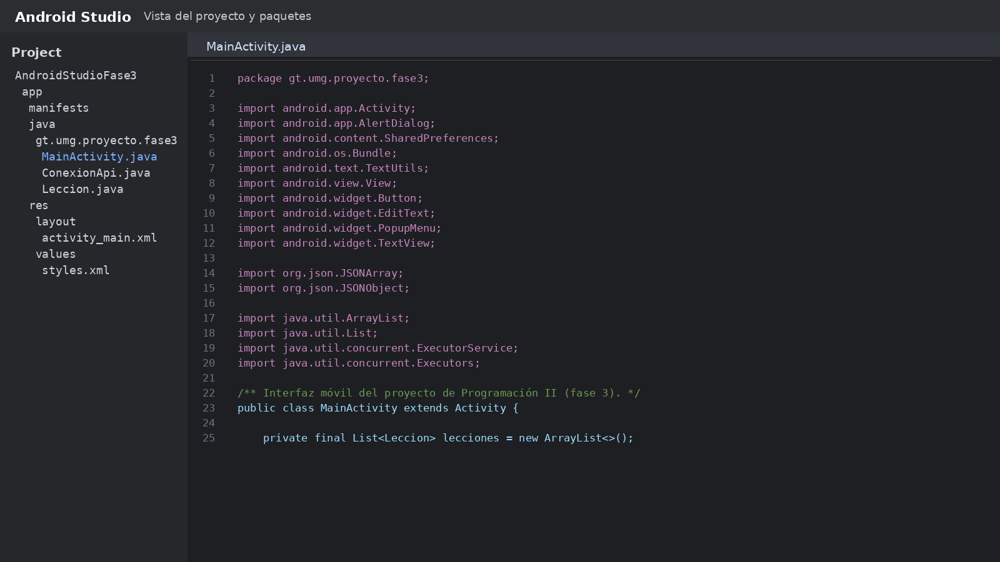

## 4. Configurar Gradle y el archivo Manifest

En el archivo `app/build.gradle` se define la configuración principal del proyecto Android: `compileSdk`, `minSdk`, `targetSdk`, y compatibilidad con Java 17.

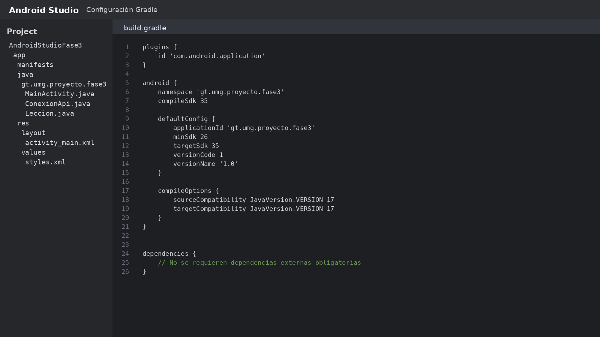

En `AndroidManifest.xml` se declara el permiso de internet, necesario para consumir la API REST de la fase 2.

## 5. Diseñar la interfaz principal en XML

El archivo `activity_main.xml` define la pantalla principal del proyecto. Se utilizó un `ScrollView` con un `LinearLayout` vertical para construir la interfaz.

Los elementos visibles que exige el enunciado son:

- Barra superior con opciones de **Lecciones**, **Configuración**, **Historial** y **Ayuda**.
- **Lección activa**.
- **Panel de lección activa**.
- **Editor de código Java**.
- Botones **Compilar** y **Ejecutar**.
- **Panel de consola** con el estado del trabajo del estudiante.

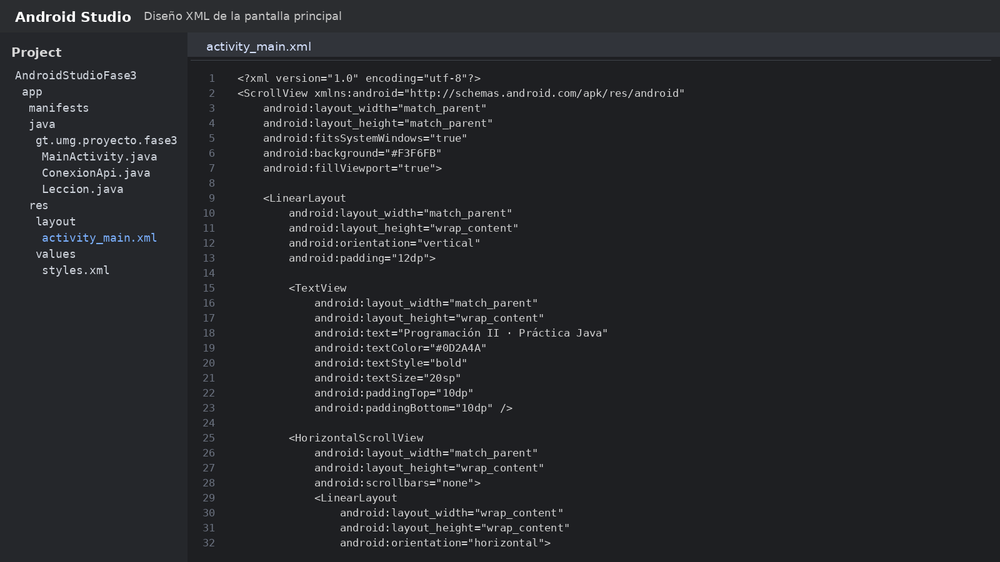

## 6. Programar la lógica en Java

La clase principal es `MainActivity.java`. En ella se inicializan los controles de la interfaz, se preparan lecciones locales de ejemplo y se agregan los eventos para los menús y botones.

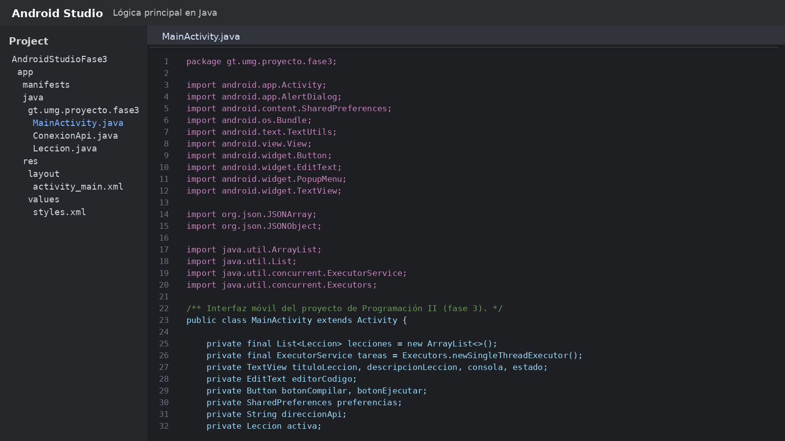

Además, el proyecto incluye:

- `Leccion.java`: modelo simple para las lecciones.
- `ConexionApi.java`: clase para consultar la API REST usando `HttpURLConnection`.

## 7. Resultado visual del Front-End Android

### 7.1 Pantalla principal

La aplicación inicia con la estructura general solicitada y con los botones de acción visibles.

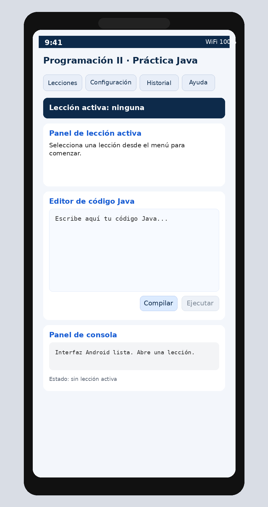

### 7.2 Menú de lecciones

El botón **Lecciones** despliega un menú contextual con las opciones principales.

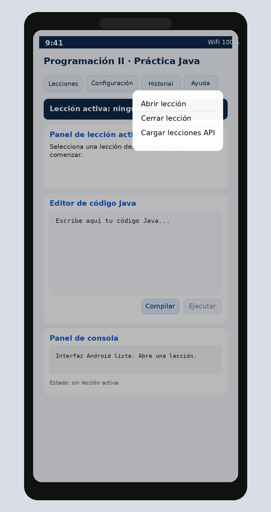

Después, el usuario puede seleccionar una lección desde un cuadro de diálogo.

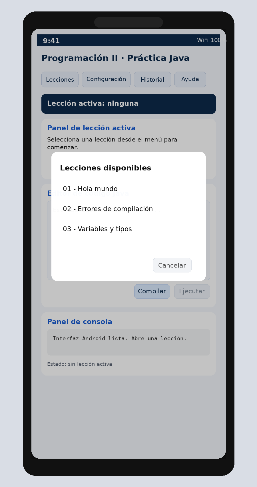

### 7.3 Lección activa y editor de código

Al abrir una lección, la interfaz muestra la descripción del ejercicio y deja disponible el editor.

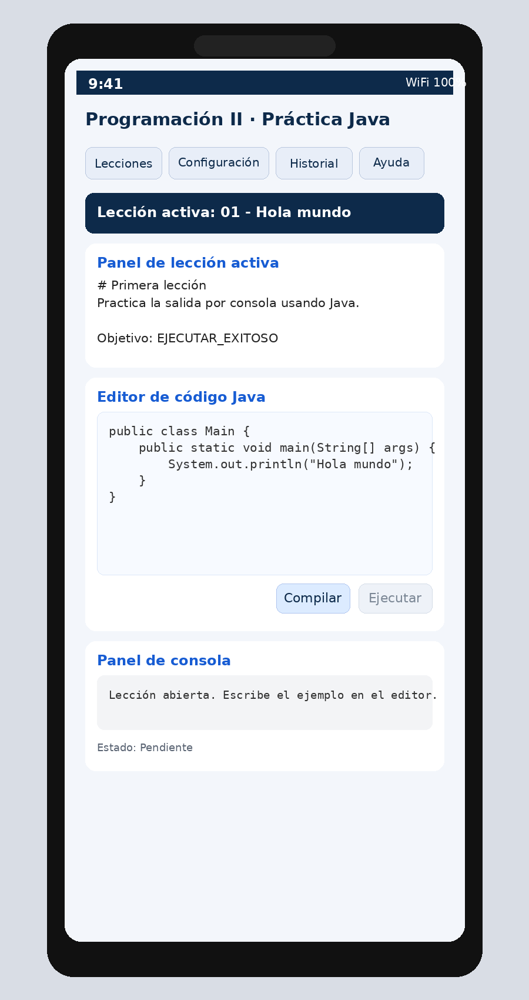

### 7.4 Configuración de la API REST

La opción **Configuración** permite guardar la dirección base del backend REST de la fase 2. Para el emulador Android se utiliza la dirección `http://10.0.2.2:8080/api`.

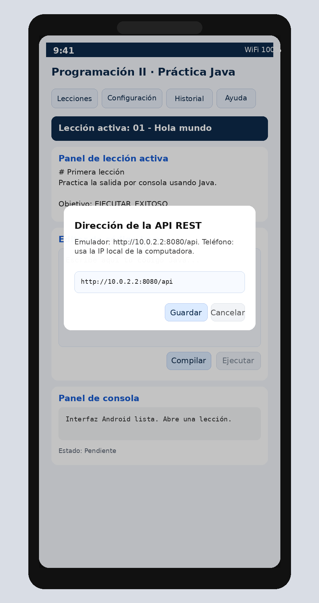

### 7.5 Historial

La opción **Historial** consulta los registros guardados desde la fase 2 y los presenta en un cuadro de diálogo.

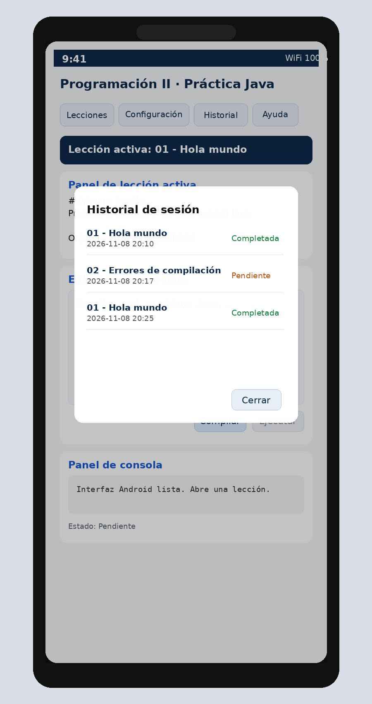

### 7.6 Ayuda

La opción **Ayuda** orienta al usuario sobre cómo utilizar el sistema.

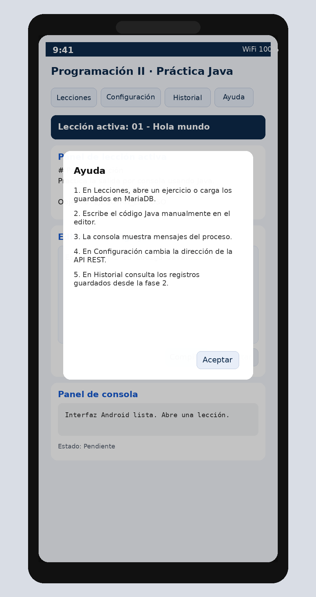

### 7.7 Compilar y Ejecutar

La interfaz móvil conserva los botones **Compilar** y **Ejecutar** para mantener coherencia con la fase 2. En esta implementación, la aplicación explica que la compilación real pertenece a la versión de escritorio y al uso de `guali-dev.jar`.

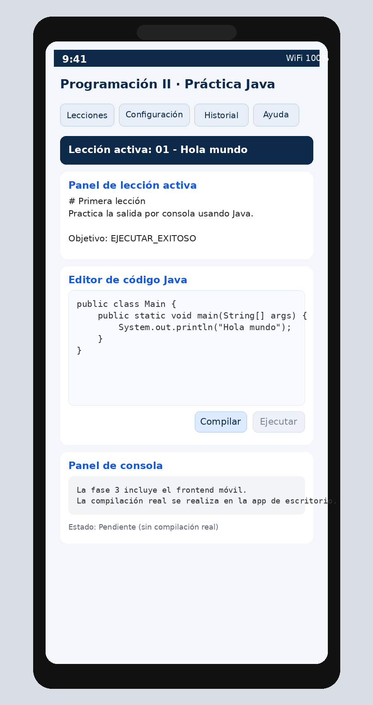

## 8. Integración con la fase 2

La aplicación Android puede conectarse al backend REST de la fase 2 para reutilizar los datos ya almacenados en MariaDB. El flujo es el siguiente:

1. Iniciar el backend de la fase 2 en la computadora.
2. Verificar `http://localhost:8080/api/salud` desde el navegador.
3. En el emulador Android, configurar la dirección `http://10.0.2.2:8080/api`.
4. Consultar lecciones e historial desde la aplicación móvil.

## 9. Publicación del tutorial en GitHub

Para cumplir completamente la fase 3, este tutorial debe publicarse en un repositorio público de GitHub.

Pasos recomendados:

1. Crear un repositorio público en GitHub.
2. Subir el contenido completo de esta carpeta.
3. Verificar que `TUTORIAL-fase-3-3190-25-16732.md` se visualice correctamente con sus imágenes.
4. Copiar la URL pública del archivo o del repositorio.
5. Colocar esa URL en el manual técnico PDF.

## 10. Conclusión

Con este proyecto se desarrolló el front-end móvil Android solicitado para la fase 3, manteniendo la línea visual y funcional del proyecto anterior. También se documentó el proceso mediante un tutorial en Markdown, con pasos ordenados, lista de prerrequisitos y capturas de apoyo.
